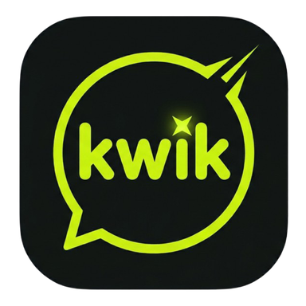

<div align="center">



# KwikChat

**Fast, light, privacy-first messaging and communities — built for Nigerian networks.**

Flutter · one codebase → Web, Android, Windows (+ iOS via macOS build)

</div>

---

## What this is

KwikChat is an @username-first social app: no phone number exposed, voice notes
that fit a 2G connection, and communities organised as `+Joints`.

This repo is the **v0.1 build**, not a mock-up. Chat is functional against a real
Supabase backend; Reels and Yarn Rooms ship as working shells (real data,
stubbed playback) and are sequenced for v0.2.

| Module | v0.1 status |
|---|---|
| Chats — 1:1 threads, voice notes, offline cache, order tags | ✅ working |
| Identity — email OTP → unique `@username`, privacy by default | ✅ working |
| Cowries — ledger-backed balance, Paystack webhook, welcome bonus | ✅ backend working, purchase sheet pending (§9) |
| `+Joints` — communities, Hype/Fade with server-ranked Hot feed | ✅ working |
| Reels — feed shell, data-saver toggle, vendor CTA | 🟡 shell (playback in v0.2) |
| Yarn Rooms — live room list, hosts, listener counts | 🟡 shell (LiveKit in v0.2) |

## Get it running

1. **Backend:** follow [`docs/SETUP.md`](docs/SETUP.md) §1 — paste three SQL
   files into Supabase, copy your URL + anon key.
2. **Run:**
   ```bash
   flutter pub get
   flutter run -d chrome \
     --dart-define=SUPABASE_URL=https://xxx.supabase.co \
     --dart-define=SUPABASE_ANON_KEY=eyJ...
   ```
3. **Ship:** `git tag v0.1.0 && git push origin v0.1.0` → Android APK, Windows
   zip and the web bundle appear on your **Releases** page.

**Platform notes.** Web, Android and Windows are verified building in CI.
iOS needs a macOS runner plus your signing identity — no Linux machine can
produce it (`docs/SETUP.md` §3). Linux desktop is parked for v0.1 because
`record_linux` 0.7.2 no longer implements `RecordPlatform.startStream`; Windows
and the web build cover desktop users until that plugin catches up.

## Why the architecture looks like this

- **Offline-first chat.** Messages render from a local cache instantly; the
  network catches up. `LocalCache` is an interface, so swapping
  `shared_preferences` for Drift later touches one file.
- **The server is the source of truth for money.** Cowries exist only as ledger
  rows; balances are a trigger-maintained cache; every mutation is an RPC that
  derives its user from the JWT.
- **RLS is the security boundary**, not the client. 36 policies, no `anon`
  access, column-level grants so a client can never write a balance, a counter
  or a verification flag.
- **Media is private** by default: private bucket, opaque UUID paths, short-lived
  signed URLs.
- **Store billing is a design constraint, not an afterthought** — see
  `docs/CORRECTIONS.md` §9.

## Docs

| File | What's in it |
|---|---|
| [`docs/PRD.md`](docs/PRD.md) | The original v1.0 product/technical blueprint |
| [`docs/CORRECTIONS.md`](docs/CORRECTIONS.md) | 13 fixes applied to that blueprint, with reasoning |
| [`docs/SETUP.md`](docs/SETUP.md) | Supabase, CI secrets, Cloudflare, Paystack, first-run checklist |

## Repo layout

```
lib/
  config/env.dart           build-time config (--dart-define)
  theme/kwik_theme.dart     Tungsten Graphene tokens, dark + daylight
  data/                     models, API client, local cache, audio bridge
  state/providers.dart      Riverpod controllers (chat list, thread, prefs)
  ui/screens/               gate, onboarding, claim, shell, 4 tabs, thread
  ui/widgets/               design-system widgets, voice recorder + player
supabase/
  migrations/0001_init.sql  schema, RLS, triggers, RPCs, views
  migrations/0002_storage.sql private media bucket + policies
  functions/paystack-webhook/  signature-verified, idempotent crediting
.github/workflows/          CI + multi-platform release pipeline
web/                        PWA shell, manifest, icons
```

## Convention notes

- Platform folders (`android/`, `windows/`, `linux/`, `ios/`, `macos/`) are
  **generated by CI** with `flutter create`, so they can never drift from the
  Flutter version. `web/` is committed because we own the PWA shell.
- Secrets live in GitHub Actions secrets and `supabase secrets` — never in the
  repo, never in the Dart binary except the public anon key.

## Roadmap

- **v0.2** — Reels playback (HLS ladder + 480p data-saver rendition), LiveKit
  Yarn Rooms, vendor profiles and commerce hooks, store-compliant Cowrie
  purchase sheet, Linux desktop once `record_linux` is compatible.
- **v0.3** — E2EE with a written threat model, R2 media with participant-scoped
  presigning, push notifications (FCM/APNs), Pidgin/Yoruba/Hausa/Igbo
  transcription.

---

<div align="center"><sub>No long talk.</sub></div>
